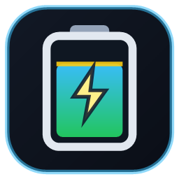

<p align="center">
  
</p>

<h1 align="center">🔋 Síragon Battery Guard v2.0</h1>
<p align="center">
  <b>Limitador de carga, monitor térmico del EC y gestor de perfiles de energía para laptops Síragon UB-8000 (<code>ARN25C-140M</code> — AMD Ryzen 7 7840U)</b>
</p>

---

## 🚀 Instalación Rápida

1. Descarga y ejecuta **[`SiragonBatteryGuard_Setup.exe`](SiragonBatteryGuard_Setup.exe)** (instalador gráfico todo-en-uno de `~104 KB`, sin dependencias externas).
2. El instalador copiará la aplicación en `%LocalAppData%\Programs\SiragonBatteryGuard`, creará los accesos directos en el Escritorio y Menú Inicio, configurará el inicio automático con Windows y registrará el desinstalador oficial en **Configuración de Windows → Aplicaciones instaladas**.
3. También puedes usar directamente la versión portable **[`SiragonBatteryGuard.exe`](SiragonBatteryGuard.exe)**.

---

## ✨ Características Principales

### 1. 🎛️ Perfiles de Energía Nativos (`powrprof.dll` + `powercfg`) — Solución al Bug ACPI del BIOS
El BIOS `1.03` de la Síragon UB-8000 declara el símbolo externo `\_SB.PCI0.SBRG.EC0.FCMI` en su tabla ACPI DSDT sin definir su dirección física en la región `ERAX`, provocando que el método WMI `PowerSwitchInterface.SetPowerMode` falle en `wmiacpi.sys`.

**Síragon Battery Guard v2.0** resuelve esto comunicándose directamente con el motor de energía de Windows 11 (`PowerSetActiveOverlayScheme` / `PowerGetEffectiveOverlayScheme`) y ajustando el techo de frecuencia del procesador (`PROCTHROTTLEMAX`) sin requerir permisos de Administrador:
- **🌿 Eco / Silencio**: Activa el overlay de máxima eficiencia energética y limita el boost al `85%` en CA (`75%` en batería).
- **⚖️ Equilibrado**: Esquema equilibrado estándar de Windows (`100%` en CA).
- **🚀 Rendimiento**: Overlay de máximo rendimiento (`100%` CPU boost) para juegos y cargas pesadas.
- **❄️ Carga Fría**: Limita el procesador al `65%` mientras cargas la batería para reducir el calor del chasis y proteger las celdas de litio contra degradación térmica.

### 2. 📊 Telemetría en Tiempo Real y Sensor Térmico del EC
- **Potencia en tiempo real (`W`)**, **Voltaje (`V`)** y **Capacidad restante (`Wh` sobre `60.0 Wh`)**.
- **Temperatura real del CPU (`°C`)** leída directamente del registro `EC0.CPUT` (offset `0x70`) expuesto por la zona térmica ACPI `\_TZ.TZ01`.
- **Cálculo de tiempo estimado (ETA)** hasta alcanzar el umbral configurado (ej. `80%`) o autonomía restante en batería.

### 3. ⚡ Guardián de Carga y Bandeja del Sistema
- Umbral máximo configurable (`50%–100%`, recomendado `80%`) y alerta de batería baja (`10%–45%`).
- Activación automática opcional del modo **❄️ Carga Fría** al alcanzar el límite configurado.
- Ícono en la bandeja del sistema (*System Tray*) con menú rápido de perfiles y notificaciones nativas de Windows.

---

## 🛠️ Compilación desde el Código Fuente

No requiere instalar Visual Studio ni SDKs pesados; utiliza el compilador nativo de .NET Framework incluido en Windows:

```powershell
powershell -ExecutionPolicy Bypass -File .\build.ps1
```

## 📁 Estructura del Repositorio

- `SiragonBatteryGuard_Setup.exe` — Instalador gráfico autocontenido para Windows.
- `SiragonBatteryGuard.exe` — Ejecutable portable.
- `src/SiragonBatteryGuard.cs` — Código fuente de la aplicación principal.
- `src/Installer.cs` — Código fuente del instalador y desinstalador gráfico.
- `src/generate_icon.ps1` — Generador vectorial del ícono multirresolución (`256x256` a `16x16`).
- `assets/battery.ico` y `assets/battery_preview.png` — Ícono oficial de la aplicación.
- `build.ps1` — Script de compilación.
